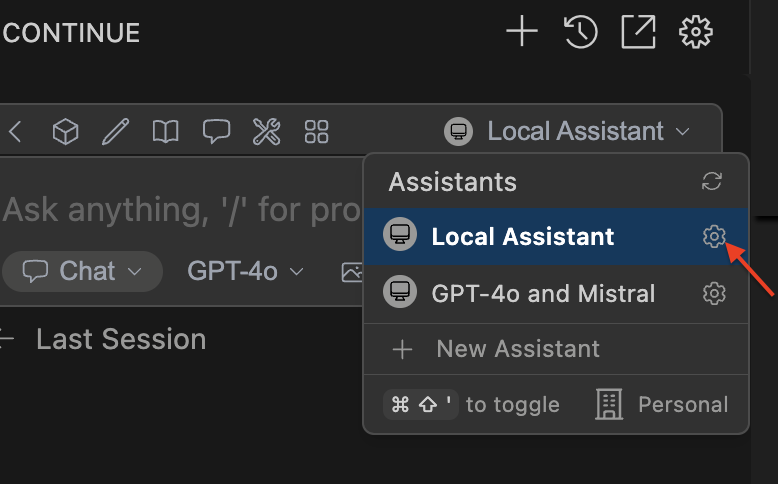

# Seedance by Ace Data Cloud — Continue MCP block

Seedance video tools in Continue through your own Ace Data Cloud account. This is an independent service block; it reuses [the existing MCP server](https://github.com/AceDataCloud/SeedanceMCP) rather than copying its implementation. It is provided by Ace Data Cloud and is not an official Seedance product.

**Distribution status (2026-10-19): published local installation files, not listed in Continue Hub.** Current Continue source removed Hub package loading and slug resolution. There is no verified working Hub search/publish/install path. The local-file route below is usable by supported Continue versions, but it does not meet official catalog discovery. [Official removal evidence](https://github.com/continuedev/continue/blob/5522c6f44ca0ac3528b37244818fbfa39b5af470/extensions/cli/src/hubLoader.ts).

## 1. Install this service block

Install Continue from its [official VS Code extension page](https://marketplace.visualstudio.com/items?itemName=Continue.continue), or use an existing supported installation. Keep your current chat model configured separately. Download only [this service YAML](https://github.com/AceDataCloud/ContinueIntegrations/releases/latest/download/seedance-by-acedatacloud.continue.yaml), or its English/Chinese ZIP from the [published release](https://github.com/AceDataCloud/ContinueIntegrations/releases/latest), then save it as **`.continue/mcpServers/seedance-acedatacloud.yaml`** in your workspace. Do not copy the whole Top5 catalog to install one service. Existing servers remain separate.

Open Continue → Local Config → the gear to inspect the selected configuration. The official historical screenshot below identifies that entry; it is not a screenshot of this service installed or running.



Source: [Continue configuration guide](https://docs.continue.dev/customize/deep-dives/configuration), original asset last committed 2025-07-10, product version unspecified. Do not infer a new Ace button or Hub listing from this image.

## 2. Register and get a dedicated API token

1. [Register or sign in → Applications](https://platform.acedata.cloud/console/applications?utm_source=continue&utm_medium=integration&utm_campaign=ecosystem-growth&utm_content=seedance_api_key). Open **General application**; if absent, choose **Initialize General Application**.
2. Copy its API Key, or **Manage Keys → Create** a separate key named `Continue Seedance`. Check expiration, service access, usage limits, balance and [current prices](https://platform.acedata.cloud/models?utm_source=continue&utm_medium=integration&utm_campaign=ecosystem-growth&utm_content=seedance_pricing). There is no fixed free allowance promised here.
3. If **Allowed APIs** is enabled, include the chosen generation API and its task-query API: `/seedance/videos`, `/seedance/tasks`. Choose the exact current model and inspect the service schema before generating.


These redacted account screenshots come from the published Suno for Dify guide; the account Key controls are shared. They are not Continue authorization screenshots. Copy the raw API token, without `Bearer ` or quotes. An account-management `platform-...` token is not the service token.

## 3. Put the token in Continue

In your own `~/.continue/.env` (Windows: `%USERPROFILE%\.continue\.env`), save:

```dotenv
ACEDATACLOUD_API_TOKEN=PASTE_YOUR_API_TOKEN_HERE
```

The YAML contains the Secret placeholder, not the token. Keep `.env` private and out of Git. The model's `ACEDATACLOUD_API_KEY` is separate from this MCP service token. IDE and CLI Secret precedence differs; make sure an older user/project `.env` is not providing the wrong Key.

## 4. Check loading, then use the service deliberately

Reload Continue and inspect the configured MCP server/tools in Agent mode. Confirm the server title **Seedance by Ace Data Cloud** and exact tools `seedance_generate_video` / `seedance_get_task`. Tool listing alone is a free transport check, not a successful media generation. After reviewing tool names, call `seedance_list_models` only if you want static model reference data. It does not verify generation access or balance.

When you explicitly choose a paid first use after checking current access and price, ask Continue to call **`seedance_generate_video`** with the current tool schema. An illustrative input is:

```json
{
  "prompt": "A simple test prompt you have reviewed"
}
```

This input is documentation, not a task this repository has submitted. Preserve the returned `task_id`. Query **`seedance_get_task`** using the **same ID** until terminal success or failure. Do not resubmit generation to poll. A pending task or preview URL is not the final result; open only the final media URL from a successful task and check the account's matching usage/bill. [Current service guide](https://platform.acedata.cloud/documents/seedance?utm_source=continue&utm_medium=integration&utm_campaign=ecosystem-growth&utm_content=seedance_service_guide).

This independently loadable block connects only this service endpoint; token permissions still control API access.

## Troubleshooting

- **Missing block/server:** check `.continue/mcpServers/` and the YAML's `name/version/schema` fields, then reload; Hub slugs are not supported by current Continue source.
- **401:** check raw token, expiry, loaded `.env`, and API restrictions. **403:** inspect access/moderation errors. Balance and upstream errors are separate conditions.
- **Tool not selected:** use a tool-capable chat model and verify Agent tool policy. Model requests may also cost credits.
- **Task pending:** keep polling the same ID. Do not repeat generation or promise a fixed completion time.

[简体中文](README_zh-CN.md) · [Existing MCP package](https://pypi.org/project/mcp-seedance/)
